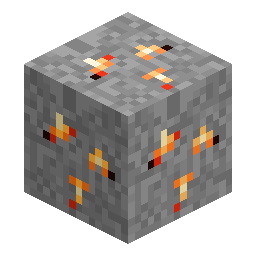

# Cindrite Ore

> **Moved to Neroland Core.** Since Neroland Core 1.25.0 this ore and the material it drops are Core
> blocks and items (`nerolandcore:` ids). Nerospace still generates them exactly where it did, and blocks
> and items from older worlds are remapped automatically. Without Nerospace, an **Ore Reclaimer** (Neroland
> Core) slowly turns them into vanilla materials. See the Neroland Core wiki.

<!-- nerospace:render -->

<!-- /nerospace:render -->

The signature crystal of the volcanic moon **Cindara**.

## Overview

Cindrite is a glowing ember-coloured gem found only on Cindara. It is rarer than the Greenxertz ores
and sits deeper, rewarding a trip to the most hostile world in the mod.

## Obtaining

- **Mining:** requires an **iron-tier pickaxe** or better. Drops the **Cindrite** gem directly

  (Fortune-affected).

- **Generation:** spawns in the **Cindara** dimension, in a triangular band roughly **y −48 to y 48** —

  rarer than the Greenxertz ores.

## Use

- Pack into a **[Block of Cindrite](Block-of-Cindrite)** for storage.
- Upgrade a **[Terraformer](Terraformer)** to **Tier 3** (drop a Cindrite into its upgrade slot).
- Craft **Tier 2** and **Thermal** [Oxygen Suit](Oxygen-Suit) pieces (4 Cindrite per piece).
- Part of the **Tier 4 rocket** recipe.

## Details

- ID: `nerolandcore:cindrite_ore` · Dimension: Cindara
- Tool: pickaxe, iron tier · Drops: Cindrite (gem)
