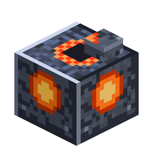

# Combustion Generator

<!-- nerospace:render -->
<p align="right"></p>
<!-- /nerospace:render -->

Burns fuel into energy (FE) for the pipe network.

## Obtaining

**Craft** (shaped): a nerosteel frame around a Furnace, wired with Redstone —

```text
N N N
N F N
N R N
```

`N` = Nerosteel Ingot · `F` = Furnace · `R` = Redstone

## How it works

- **Fuel slot** (GUI, hand or hopper/pipe fed): coal, charcoal, coal blocks, blaze rods, or Rocket

  Fuel Canisters.

- Burning makes **20 FE/t** into a **100,000 FE** buffer. It only burns fuel while the buffer is not

  full, so no fuel is wasted.

- Burn times: coal or charcoal **1,600 ticks**, coal block **16,000 ticks**, blaze rod **2,400 ticks**,

  Rocket Fuel Canister **4,000 ticks**.

- **Auto-push:** it pushes power into any machine or Battery that touches it. No cable is needed.
- A Universal Pipe (energy layer) can also pull power out. Total output is up to **1,280 FE/t**.

- GUI shows the power buffer and burn progress; emits a comparator signal from its charge.

## Details

- ID: `nerospace:combustion_generator` · Tool: pickaxe, iron tier · Drops: itself
- Config: output scales with `energyRateMultiplier`. See [Configuration](Configuration).
