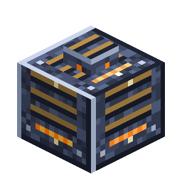

# Fuel Refinery

<!-- nerospace:render -->
<p align="right"></p>
<!-- /nerospace:render -->

Refines coal + blaze powder + grid energy into pipeable liquid rocket fuel.

## Overview

The Fuel Refinery is the **logistics-grade** way to make rocket fuel. Instead of hand-crafting
canisters, feed it raw **coal** (or charcoal), **blaze powder** and **grid power**, and it produces
liquid **Rocket Fuel** in an internal tank that [Universal Pipes](Universal-Pipe) can pull straight
into a [Fuel Tank](Fuel-Tank) or a padded rocket. It is craftable before your first launch.

## Obtaining

**Craft** (shaped):

```text
N G N
N F N
N R N
```

`N` = Nerosteel Ingot · `G` = Glass · `F` = Furnace · `R` = Redstone

(Ingredients are tag-based, so other mods' iron-equivalent glass/redstone work too.)

## How it works

- **Inputs:** a **carbon** slot (coal or charcoal) and a **catalyst** slot (blaze powder). Hoppers and

  pipes feed them through the item capability — coal routes to carbon, blaze to catalyst automatically.

- **Power:** grid power only. It holds **40,000 FE** and accepts up to 1,000 FE/tick. Feed it from a generator or Battery over

  [Universal Pipes](Universal-Pipe).

- **Refining:** one batch consumes **1 coal + 1 blaze powder + ~4,000 FE** over ~100 ticks and yields

  **2,000 mB** of rocket fuel — the same fuel two hand-crafted canisters give, without the iron or the
  clicking.

- **Output:** the internal **8,000 mB** tank exposes the fluid capability, so pipes carry the fuel away.
- **Auto-push:** it pushes up to **200 mB/t** of fuel into any tank or pipe that touches it, by itself.
- **Comparator:** emits a redstone signal scaled to its fuel level.

`fuelCostMultiplier` scales the power use (FE/t) and `machineSpeedMultiplier` scales the cycle time.
`energyRateMultiplier` does not apply. See [Configuration](Configuration).

## Details

- ID: `nerospace:fuel_refinery` · Tool: pickaxe, iron tier · Drops: itself
