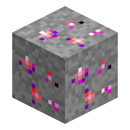

# Nerosium Ore

> **Moved to Neroland Core.** Since Neroland Core 1.25.0 this ore and the material it drops are Core
> blocks and items (`nerolandcore:` ids). Nerospace still generates them exactly where it did, and blocks
> and items from older worlds are remapped automatically. Without Nerospace, an **Ore Reclaimer** (Neroland
> Core) slowly turns them into vanilla materials. See the Neroland Core wiki.

<!-- nerospace:render -->

<!-- /nerospace:render -->

The mod's starting material — a red/purple cosmic crystal embedded in stone.

## Overview

Nerosium is the first Nerospace material and the gateway to its tech tree. **Nerosium Ore** is the
stone-height variant; the [Deepslate Nerosium Ore](Deepslate-Nerosium-Ore) variant appears deeper.

## Obtaining

- **Mining:** requires an **iron-tier pickaxe** or better. Drops **Raw Nerosium** (affected by Fortune).
- **Got the ore block instead of Raw Nerosium?** Your pickaxe has **Silk Touch**. That's fine: smelt the
  ore block straight into an ingot (needs Nerospace **1.5.1** or newer), or grind it into 2 Nerosium Dust.
  Use a pickaxe *without* Silk Touch if you want Raw Nerosium.
- **Generation:** spawns in **all Overworld biomes** in the underground-ores step, in a triangular

  height band roughly **y −24 to y 56** (peaking around y 16), at a similar rate to iron.

## Use

- Smelt or blast **Raw Nerosium** (or the ore itself) into a **Nerosium Ingot**.
- For more yield, run it through a **[Nerosium Grinder](Nerosium-Grinder)**: one ore grinds into

  **2 Nerosium Dust**, and each dust smelts into an ingot — effectively doubling your output.

## Details

- ID: `nerolandcore:nerosium_ore`
- Tool: pickaxe, iron tier · Drops: Raw Nerosium
