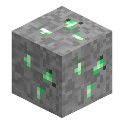

# Nerosteel Ore

<!-- nerospace:render -->

<!-- /nerospace:render -->

The primary metal of the **Greenxertz** planet.

## Overview

Nerosteel is an iron-class metal and the backbone of mid-game crafting — rockets, the Oxygen Suit,
machines and station blocks are all built from **Nerosteel Ingots**. **Greenxertz** is its home and
its abundant source, but a small, deep seam also occurs on the **Overworld** so the metal that gates
your first rocket is reachable before you ever leave home.

## Obtaining

- **Mining:** requires an **iron-tier pickaxe** or better. Drops **Raw Nerosteel** (Fortune-affected).
- **Generation:**
  - **Overworld:** a **rare, deep** seam — roughly **y −56 to y 16** (peaking below sea level), about a

    40% as common as on Greenxertz (4 veins per chunk vs 10). Enough to bootstrap the power grid and a first rocket.

  - **Greenxertz:** common throughout the dimension, in a triangular band roughly **y −32 to y 72** —

    the place to mine it in bulk once you arrive.

## Use

- Smelt or blast **Raw Nerosteel** (or the ore) into a **Nerosteel Ingot**.
- The [Nerosium Grinder](Nerosium-Grinder) turns 1 ore into **2 Raw Nerosteel**.
- Nerosteel Ingots craft the [Rocket Launch Pad](Rocket-Launch-Pad), [Fuel Tank](Fuel-Tank),

  [Oxygen Generator](Oxygen-Generator), [Station Floor](Station-Floor)/[Wall](Station-Wall), the
  Oxygen Suit, and the rockets themselves.

## Details

- ID: `nerospace:nerosteel_ore` · Dimensions: Overworld (rare, deep) + Greenxertz (common)
- Tool: pickaxe, iron tier · Drops: Raw Nerosteel
