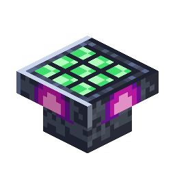

# Passive Generator

<!-- nerospace:render -->
<p align="right"></p>
<!-- /nerospace:render -->

A slow, hands-off trickle of energy from a nerosium core.

## Obtaining

**Craft** (shaped): a nerosteel frame around a Block of Nerosium, wired with Redstone —

```text
N N N
N B N
N R N
```

`N` = Nerosteel Ingot · `B` = Block of Nerosium · `R` = Redstone

## How it works

- **Core slot** (GUI, hand or hopper/pipe fed): raw nerosium, a nerosium ingot, or nerosium dust.
- One Raw Nerosium, Nerosium Ingot or Nerosium Dust runs for **24,000 ticks (20 minutes)**, making
  **8 FE/t** into a **100,000 FE** buffer.
- **Auto-push:** it pushes power into any machine or Battery that touches it. A pipe can also pull it out.
- Weaker than the Combustion Generator but ideal as set-and-forget base power.
- A [Nerosium Grinder](Nerosium-Grinder) uses 20 FE/t, so one Passive Generator runs a grinder at about
  40% speed. That is fine for a start.

## Details

- ID: `nerospace:passive_generator` · Tool: pickaxe, iron tier · Drops: itself
- Config: output scales with `energyRateMultiplier`. See [Configuration](Configuration).
