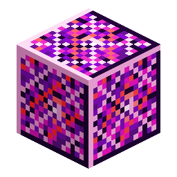

# Blocco di Nerosium

> Questa pagina è una bozza tradotta automaticamente; fa fede la versione inglese: [English](../../Block-of-Nerosium.md).

<!-- nerospace:render -->

<!-- /nerospace:render -->

Stoccaggio compatto per nove lingotti di Nerosium.

## Panoramica

Un blocco decorativo e di stoccaggio di Nerosium raffinato. Serve solo per lo stoccaggio compatto e per costruire; non ha alcun comportamento da macchina.

## Come ottenerlo

- **Fabbricazione:** riempi una griglia 3×3 con **lingotti di Nerosium**.
- **Scomposizione:** fabbrica il blocco da solo per riavere **9 lingotti di Nerosium**.
- È anche l'ingrediente principale della **[Rampa di lancio per razzi](Rocket-Launch-Pad.md)**.

## Dettagli

- ID: `nerospace:nerosium_block`
- Attrezzo: piccone, livello ferro · Drop: se stesso
