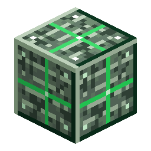

# Blocco di Nerosteel

> Questa pagina è una bozza tradotta automaticamente; fa fede la versione inglese: [English](../../Block-of-Nerosteel.md).

<!-- nerospace:render -->

<!-- /nerospace:render -->

Stoccaggio compatto per nove lingotti di Nerosteel.

## Panoramica

Un blocco di stoccaggio e costruzione di Nerosteel raffinato. Compare anche come componente principale nelle ricette dei razzi.

## Come ottenerlo

- **Fabbricazione:** riempi una griglia 3×3 con **lingotti di Nerosteel**.
- **Scomposizione:** fabbrica il blocco da solo per riavere **9 lingotti di Nerosteel**.
- Usato come nucleo del motore nei **razzi di livello 1 / 2 / 3**, e anche nel **razzo di livello 4** e nel **[Terraformatore](Terraformer.md)**.

## Dettagli

- ID: `nerospace:nerosteel_block`
- Attrezzo: piccone, livello ferro · Drop: se stesso
