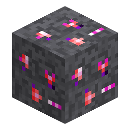

# Minerale di Nerosium in ardesia oscura

> Questa pagina è una bozza tradotta automaticamente; fa fede la versione inglese: [English](../../Deepslate-Nerosium-Ore.md).

<!-- nerospace:render -->

<!-- /nerospace:render -->

La variante in ardesia oscura del [Minerale di Nerosium](Nerosium-Ore.md), che si trova nella parte inferiore della sua fascia.

## Panoramica

Drop e utilizzi identici al Minerale di Nerosium, ma incastonato nell'ardesia oscura, quindi è un po' più duro da estrarre.

## Come ottenerlo

- **Estrazione:** richiede un **piccone di livello ferro** o migliore. Lascia cadere **Nerosium grezzo** (influenzato da Fortuna). Con un piccone con **Tocco di velluto** lascia cadere invece il blocco di minerale: fondilo direttamente in un lingotto (1.5.1+) o macinalo in 2 Polvere di Nerosium.
- **Generazione:** la forma in ardesia oscura del giacimento di Nerosium dell'Overworld (compare dove il giacimento

  incontra l'ardesia oscura, nella parte inferiore della fascia **da y −24 a y 56**).

## Utilizzo

Come il [Minerale di Nerosium](Nerosium-Ore.md): fondi il Nerosium grezzo (fornace o forno fusorio) in un **lingotto di Nerosium**, oppure macinalo in un **[Macinatore di Nerosium](Nerosium-Grinder.md)** per una resa doppia.

## Dettagli

- ID: `nerospace:deepslate_nerosium_ore`
- Attrezzo: piccone, livello ferro · Drop: Nerosium grezzo
