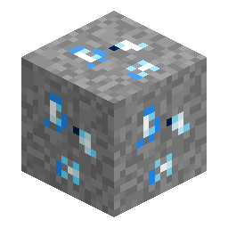

# Minerale di Glacite

> Questa pagina è una bozza tradotta automaticamente; fa fede la versione inglese: [English](../../Glacite-Ore.md).

<!-- nerospace:render -->

<!-- /nerospace:render -->

Il cristallo simbolo della luna ghiacciata **Glacira**.

## Panoramica

La Glacite è una gemma azzurro ghiaccio pallido che si trova solo su Glacira, la destinazione di livello 4. Chiude il cerchio della fase avanzata: rinforza la **Tuta criogenica** contro il freddo di Glacira e alimenta la **fase dell'acqua** della terraformazione avanzata.

## Come ottenerlo

- **Estrazione:** richiede un **piccone di livello ferro** o migliore. Lascia cadere direttamente la gemma di **Glacite**

  (influenzata da Fortuna).

- **Generazione:** compare nella dimensione **Glacira**, in una fascia circa da **y −48 a y 48**, con rarità simile

  alla [Cindrite](Cindrite-Ore.md).

## Utilizzo

- Compattala in un **[Blocco di Glacite](Block-of-Glacite.md)** per lo stoccaggio.
- Fabbrica la **[Tuta criogenica](Oxygen-Suit.md)** (ogni pezzo = pezzo di livello 2 + 4 Glacite): senza di essa il freddo di Glacira

  quadruplica il consumo di ossigeno.

- Fabbrica e alimenta il **[Modulo di idratazione](Hydration-Module.md)**, che scioglie la Glacite nel ciclo dell'acqua

  che porta il terreno di un [Terraformatore](Terraformer.md) da *Radicato* a *Idratato*.

## Dettagli

- ID: `nerospace:glacite_ore` · Dimensione: Glacira
- Attrezzo: piccone, livello ferro · Drop: Glacite (gemma)
