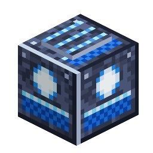

# Modulo di idratazione

> Questa pagina è una bozza tradotta automaticamente; fa fede la versione inglese: [English](../../Hydration-Module.md).

<!-- nerospace:render -->
<p align="right"></p>
<!-- /nerospace:render -->

L'ingresso di Glacite della terraformazione avanzata: scioglie la Glacite in **unità di idratazione** che alimentano la fase **Idratato** (acqua) del [Terraformatore](Terraformer.md).

## Panoramica

La terraformazione avanzata procede per fasi: Radicato → Idratato → Vivo. La fase Idratato riempie di vera acqua i bacini sotto la falda del Terraformatore, e ogni sorgente d'acqua piazzata costa **1 unità di idratazione**. Il Modulo di idratazione è da dove arrivano queste unità: scioglie la Glacite (ghiaccio d'acqua cristallizzato estratto su [Glacira](Home.md)) nella riserva di idratazione del Terraformatore.

## Come ottenerlo

**Fabbricazione** (con forma):

```text
G N G
N F N
G N G
```

`G` = Glacite · `N` = Lingotto di Nerosteel · `F` = [Serbatoio di fluidi](Fluid-Tank.md)

## Come funziona

- **Deve toccare il Terraformatore:** piazzalo direttamente contro una qualsiasi faccia di un blocco Terraformatore.

  Un modulo anche a un solo blocco di distanza non fornisce nulla.

- **Dagli Glacite:** metti Glacite (16 unità ciascuna) o Blocchi di Glacite (144 unità) nel suo slot

  di ingresso, a mano, con tramoggia o tubo per oggetti (lo slot è esposto all'automazione).

- **Scioglie un oggetto per impulso** nella riserva di idratazione del Terraformatore collegato (massimo 1.024 unità);

  non scioglie mai un oggetto che la riserva non può contenere per intero, quindi nessuna unità va persa.

- **Niente Glacite = la fase dell'acqua si blocca.** L'interfaccia del Terraformatore (e un

  [Monitor di terraformazione](Terraform-Monitor.md)) mostra «Serve Glacite» mentre la fase 2 è in attesa.

## Dettagli

- ID: `nerospace:hydration_module` · Attrezzo: piccone, livello ferro · Drop: se stesso
- Gli oggetti in ingresso sono definiti da un tag (`nerospace:hydration_input`): per impostazione predefinita solo Glacite; i modpack possono

  ampliarlo (il ghiaccio del gioco base è escluso di proposito, così il viaggio su Glacira resta significativo).
