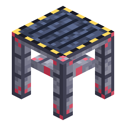

# Torre di lancio

> Questa pagina è una bozza tradotta automaticamente; fa fede la versione inglese: [English](../../Launch-Gantry.md).

<!-- nerospace:render -->
<p align="right"></p>
<!-- /nerospace:render -->

La torre d'imbarco che trasforma una rampa 5×5 nel **Complesso di lancio pesante**.

## Panoramica

La Torre di lancio è il modulo per i lanci pesanti: piazzane almeno una accanto a una **[Rampa di lancio per razzi](Rocket-Launch-Pad.md) 5×5** completa e allineata (all'altezza della rampa) e il gruppo forma un **Complesso di lancio pesante**, il punto di partenza dei razzi più grandi e una comoda rampa d'imbarco per tutti.

## Come ottenerla

**Fabbricazione** (con forma):

```text
N . N
N I N
N S N
```

`N` = Lingotto di Nerosteel · `I` = Sbarre di ferro · `S` = [Parete della stazione](Station-Wall.md)

## Come funziona

- **Formare il complesso:** una **rampa 5×5** completa e allineata più **≥1 Torre di lancio** adiacente all'altezza della

  rampa = Complesso di lancio pesante. Fai clic destro a mani vuote su un qualsiasi blocco della rampa per un **rapporto sulla struttura**
  (dimensione del gruppo, quadrato più grande, moduli torre/carburante e il prossimo pezzo mancante).

- **Imbarco:** fai clic destro sulla torre per salire direttamente sul razzo schierato, senza dover mirare con precisione

  all'entità.

- **Vincoli di livello:**
  - Il **livello 4** si schiera e decolla **solo** su un Complesso di lancio pesante.
  - Il **livello 3** accetta il complesso pesante **oppure** il classico 3×3 + anello di [Parete della stazione](Station-Wall.md).
  - Il **livello 2** richiede una rampa 3×3 completa (o il complesso pesante).
  - Il **livello 1** richiede solo **un** blocco di rampa (o qualcosa di più grande).
  - I controlli vengono ripetuti al lancio: rompere la torre (o i blocchi della rampa) sotto un razzo schierato

    lo lascia a terra.

- **Rifornimento:** un [Serbatoio di carburante](Fuel-Tank.md) collegato a un complesso pesante pompa a **480 mB/t** (12 volte la

  velocità base): il serbatoio da 24.000 mB di un livello 4 si riempie in meno di un minuto.

Vedi la [Guida alla costruzione della rampa di lancio](Launch-Pad-Build-Guide.md) per la disposizione completa del livello 4.

## Dettagli

- ID: `nerospace:launch_gantry` · Attrezzo: piccone, livello ferro · Drop: se stessa
