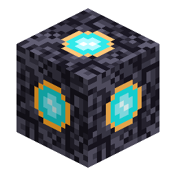

# Nucleo di meteora

> Questa pagina è una bozza tradotta automaticamente; fa fede la versione inglese: [English](../../Meteor-Core.md).

<!-- nerospace:render -->

<!-- /nerospace:render -->

Il blocco luminoso al centro di un cratere: lo «scrigno» del bottino della meteora.

## Panoramica

Ogni meteora caduta colloca un Nucleo di meteora sul fondo del suo cratere (vedi **[Eventi meteora](Meteor-Events.md)**). Contiene il bottino casuale della meteora, estratto **una sola volta** all'impatto e poi fissato, così il contenuto è identico per chiunque lo raggiunga.

## Come ottenerlo

**Non fabbricabile.** Un Nucleo di meteora viene piazzato dall'impatto di una meteora. **Rompilo per ottenere il bottino** (rompi e raccogli): le pile memorizzate si spargono dove si trovava: una manciata di **Frammenti alieni** più estrazioni bonus ponderate di minerali grezzi e dei più rari **Rottami di tecnologia aliena** / **Nucleo alieno**.

## Utilizzo

- Spaccalo per ottenere il contenuto della meteora: la spinta iniziale di materiali alieni e minerali extraterrestri.
- Gli oggetti alieni alimenteranno un futuro sistema di **scanner / potenziamenti** (vedi [Roadmap](Roadmap.md)).

## Dettagli

- ID: `nerospace:meteor_core` · Attrezzo: piccone · Nessuna tabella del bottino: quando viene rotto lascia cadere il contenuto memorizzato.
- Emette luce (livello 9).
