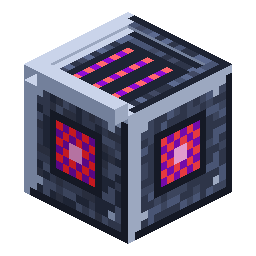

# Macinatore di Nerosium

> Questa pagina è una bozza tradotta automaticamente; fa fede la versione inglese: [English](../../Nerosium-Grinder.md).

<!-- nerospace:render -->
<p align="right"></p>
<!-- /nerospace:render -->

La tua prima macchina: macina i minerali in polvere per raddoppiare la resa di metallo.

## Panoramica

Il Macinatore di Nerosium trasforma nel tempo i materiali di Nerosium in **Polvere di Nerosium**. Poiché ogni polvere si fonde di nuovo in un lingotto di Nerosium, macinare il minerale prima di fonderlo **raddoppia** la produzione di lingotti.

## Come ottenerlo

**Fabbricazione** (con forma):

```text
I I I
I F I
C C C
```

`I` = Lingotto di Nerosium · `F` = Fornace · `C` = Pietrisco

## Come funziona

- **Slot:** un **ingresso** (sopra/lati) e una **riserva di uscita da quattro slot** (estratta dal basso). La riserva dà ai tubi il tempo di stare al passo; se si riempie, il macinatore si **mette in pausa** invece di traboccare.
- **Ricette di macinazione:**
  - Minerale di Nerosium / Minerale di Nerosium in ardesia oscura / Nerosium grezzo → **2 Polvere di Nerosium**
  - Lingotto di Nerosium → **1 Polvere di Nerosium**
  - Minerale di Nerosteel → **2 Nerosteel grezzo**
  - Minerale di Cindrite → **2 Cindrite** · Minerale di Glacite → **2 Glacite** · Minerale di quarzo Xertz → **2 quarzo Xertz**

  Le ricette per i blocchi di minerale fanno sì che il **minerale estratto con Tocco di velluto** (a mano o dal Modulo Tocco di velluto della cava) non sia mai un vicolo cieco: macinalo di nuovo nel suo materiale grezzo o nella sua gemma.
- **Energia:** il macinatore **non** produce energia da solo: mostra **0%** finché non colleghi una fonte di energia. Piazza un **[Generatore passivo](Passive-Generator.md)** (alimentalo con Nerosium grezzo) o un **[Generatore a combustione](Combustion-Generator.md)** (alimentalo con carbone) **subito accanto**: i generatori spingono da soli energia nelle macchine che toccano, senza cavi. Più lontano, collegali con i **[Tubi universali](Universal-Pipe.md)** o con una **[Batteria](Battery.md)** di Neroland Core. Vedi **[Alimentare le macchine](Powering-Machines.md)**.
- **Valori:** riserva da 20.000 FE, accetta fino a 500 FE/tick, consuma **20 FE/tick** durante la macinazione e un oggetto richiede **200 tick (10 secondi)**: quindi una macinazione costa 4.000 FE.

- **Automazione:** l'inventario è esposto tramite la capability per gli oggetti: tramogge e tubi possono **inserire nell'ingresso da sopra o dai lati ed estrarre la polvere

  dal basso**.

- **Interfaccia:** mostra un indicatore di energia e l'avanzamento della macinazione. Se la barra dell'energia resta allo **0%**, niente la sta alimentando: mettile accanto un generatore.

<a id="grinding-meteor-rock--random-space-materials"></a>

## Macinare la roccia di meteora: materiali spaziali casuali

Dai al macinatore una **[Roccia di meteora](Meteor-Rock.md)** e seguirà un percorso diverso e casuale: invece di una ricetta fissa produce un materiale casuale ponderato preso dal **Registro dei materiali delle meteore di [Neroland Core](Neroland-Core.md)**. Ogni mod Nero registra una volta in Core i propri materiali macinabili, quindi il gruppo cresce automaticamente con le mod installate: il macinatore non ha bisogno di conoscerle.

- **Cosa ottieni:** un materiale **principale** per roccia, più, di tanto in tanto, un oggetto **esotico** bonus. Nerospace contribuisce al gruppo con i suoi materiali grezzi e i minerali caratteristici dei pianeti.
- **Minerali caratteristici legati al pianeta:** il **minerale caratteristico** di ogni pianeta entra nel gruppo solo quando macini *su quel pianeta*, e lì ha un peso elevato (il moltiplicatore di vantaggio planetario). Macina su Greenxertz per quarzo Xertz e Nerosteel grezzo, su Cindara per la Cindrite, su Glacira per la Glacite. Fuori da un pianeta (per esempio sulla Terra) quei materiali scompaiono del tutto. Essere sul pianeta *è* il requisito: non c'è un blocco di progressione separato, quindi non puoi mai restare bloccato su un mondo senza poterne macinare il minerale.
- **Tecnologia aliena vincolata alla progressione:** i **materiali alieni** non sono legati a un pianeta, quindi possono uscire su qualsiasi mondo, e sono invece cadenzati dai **requisiti di Core**. I Frammenti alieni si sbloccano con **Orbita raggiunta**; i Rottami di tecnologia aliena e l'esotico **Nucleo alieno** con **Prima colonia**. Così i rari drop di fine gioco restano fuori dalle prime macinazioni di meteore nell'Overworld.
- **Contesto dell'operatore:** il controllo di requisiti e pianeta usa l'**operatore**, cioè l'ultimo giocatore che ha aperto il macinatore o il proprietario della stazione in cui si trova. Senza un operatore online (e senza materiali idonei) la macinazione semplicemente aspetta, così un macinatore incustodito non spreca mai una roccia. Se la **riserva di uscita è piena**, il macinatore si **mette in pausa** tenendo il risultato e la roccia di meteora: non lascia mai cadere oggetti nel mondo; la macinazione riprende appena si libera uno slot.
- **Ricettario:** il gruppo casuale si può consultare in **JEI** o **EMI**: cerca il macinatore e la voce della meteora mostra l'intero insieme di materiali `neroland:meteor/grindable`.

Privacy: il registro non memorizza **alcun dato dei giocatori**, solo metadati degli oggetti. L'operatore viene tenuto tramite UUID solo per il contesto dei requisiti, mai registrato nei log (POPIA/GDPR).

## Consigli

Dagli Nerosium grezzo o minerale, convoglia la polvere in una schiera di fornaci e otterrai 2 lingotti per minerale invece di 1. Tieni da parte le tue **Rocce di meteora** per la macinazione a materiale casuale, e macinale *sul pianeta corrispondente* per sbilanciare l'estrazione verso il minerale caratteristico di quel pianeta.

## Dettagli

- ID: `nerospace:nerosium_grinder` · Attrezzo: piccone, livello ferro · Drop: se stesso
