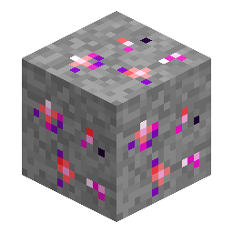

# Minerale di Nerosium

> Questa pagina è una bozza tradotta automaticamente; fa fede la versione inglese: [English](../../Nerosium-Ore.md).

<!-- nerospace:render -->

<!-- /nerospace:render -->

Il materiale di partenza della mod: un cristallo cosmico rosso/viola incastonato nella pietra.

## Panoramica

Il Nerosium è il primo materiale di Nerospace e la porta d'accesso al suo albero tecnologico. Il **Minerale di Nerosium** è la variante all'altezza della pietra; la variante [Minerale di Nerosium in ardesia oscura](Deepslate-Nerosium-Ore.md) si trova più in profondità.

## Come ottenerlo

- **Estrazione:** richiede un **piccone di livello ferro** o migliore. Lascia cadere **Nerosium grezzo** (influenzato da Fortuna).
- **Hai ottenuto il blocco di minerale invece del Nerosium grezzo?** Il tuo piccone ha **Tocco di velluto**. Va bene: fondi il blocco di minerale direttamente in un lingotto (serve Nerospace **1.5.1** o successiva), oppure macinalo in 2 Polvere di Nerosium. Usa un piccone *senza* Tocco di velluto se vuoi il Nerosium grezzo.
- **Generazione:** compare in **tutti i biomi dell'Overworld** nella fase dei minerali sotterranei, in una fascia di altezza

  triangolare circa da **y −24 a y 56** (con il picco intorno a y 16), con una frequenza simile al ferro.

## Utilizzo

- Fondi il **Nerosium grezzo** (o il minerale stesso) in fornace o forno fusorio per ottenere un **lingotto di Nerosium**.
- Per una resa maggiore, passalo in un **[Macinatore di Nerosium](Nerosium-Grinder.md)**: un minerale diventa

  **2 Polvere di Nerosium**, e ogni polvere si fonde in un lingotto, raddoppiando di fatto la produzione.

## Dettagli

- ID: `nerospace:nerosium_ore`
- Attrezzo: piccone, livello ferro · Drop: Nerosium grezzo
