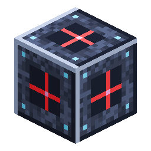

# Guida all'allestimento della cava

> Questa pagina è una bozza tradotta automaticamente; fa fede la versione inglese: [English](../../Quarry-Setup-Guide.md).

<!-- nerospace:render -->
<p align="right"></p>
<!-- /nerospace:render -->

Una guida passo passo per far scavare il tuo primo [Controllore della cava](Quarry-Controller.md), dalla fabbricazione delle parti alla raccolta del minerale. Per il riferimento completo (ogni riga di stato, danni al telaio, caricamento dei chunk, livelli) vedi la pagina [Controllore della cava](Quarry-Controller.md).

## In sintesi


1. Fabbrica le parti: un controllore, i segnaposto (o involucri in più), l'Involucro del telaio e un baule.
2. Delimita un rettangolo con **3 [Segnaposto della cava](Quarry-Landmark.md)** a L, tutti alla stessa altezza.
3. Piazza il **controllore** alla stessa altezza, subito accanto a un lato del rettangolo.
4. Carica l'**Involucro del telaio** nel controllore: costruisce il telaio.
5. Collega l'**energia** e un **baule di uscita**: scava fino al substrato roccioso e riempie il baule.

## 1. Raccogli i materiali

Tutto si costruisce con **[lingotti di Nerosteel](Items.md)** (dal Minerale di Nerosteel su Greenxertz), più qualche oggetto del gioco base.

| Parte | Ricetta | Ti serve |
| --- | --- | --- |
| [Controllore della cava](Quarry-Controller.md) | 5 lingotti di Nerosteel, 1 diamante, 2 Involucri del telaio, 1 blocco di redstone | 1 |
| [Segnaposto della cava](Quarry-Landmark.md) | Redstone sopra vetro sopra lingotto di Nerosteel: ne produce **3** | 3 (una fabbricazione) |
| [Involucro del telaio](Upgrade-Modules.md) | 8 lingotti di Nerosteel ad anello: ne produce **4** | vedi la tabella sotto |
| Fonte di energia | per esempio un [Generatore a combustione](Combustion-Generator.md) o un [Generatore passivo](Passive-Generator.md), più il [Tubo universale](Universal-Pipe.md) | 1 |
| Deposito di uscita | un baule (o un tubo verso il tuo deposito) | 1 |

**Quanti Involucri del telaio?** Il telaio è un anello attorno al rettangolo: un involucro per ogni blocco del perimetro, cioè `2 × width + 2 × length − 4` (uno in meno se il controllore si trova sull'anello stesso).

| Area (da segnaposto a segnaposto) | Blocchi scavati per strato | Involucri | Nerosteel per gli involucri |
| --- | --- | --- | --- |
| 8 × 8 | 6 × 6 | 28 | 56 |
| 16 × 16 | 14 × 14 | 60 | 120 |
| 32 × 32 | 30 × 30 | 124 | 248 |
| 64 × 64 (massima) | 62 × 62 | 252 | 504 |

> **Consiglio:** il controllore ha 4 slot per gli involucri (256 involucri), abbastanza per il telaio più grande, e riottieni ogni involucro quando lo scavo finisce, quindi il tuo primo set è riutilizzabile.

## 2. Scegli il posto

- **Pianeta:** il controllore di oggi è di **livello 1**. Funziona nell'**Overworld**, su **Greenxertz** e sulla **Stazione orbitale**. Su **Cindara** e **Glacira** mostra *In pausa: pianeta sbagliato* (sono in programma controllori di livello superiore per quelle lune).
- **Altezza:** l'altezza a cui piazzi i segnaposto è il **livello del telaio**. La cava scava quel livello e **tutto ciò che sta sotto** fino al substrato roccioso. Tutto ciò che sta **sopra** (alberi, colline, la tua casa) resta intatto: quindi piazza i segnaposto al livello del suolo, o prima scava una piazzola piana.
- **Dimensione:** ogni lato può essere lungo **da 3 a 64 blocchi**, misurati da segnaposto a segnaposto (i server possono abbassare il limite con `quarryMaxSide`: vedi [Configurazione](Configuration.md)). L'anello esterno diventa il telaio, quindi viene scavato solo l'**interno**.
- **Libera l'anello:** i blocchi sull'anello del telaio vengono **sostituiti** dal telaio (senza drop), quindi non metterci niente che vuoi conservare. Bauli e macchine sull'anello restano al loro posto, e qualsiasi cosa con un block entity *dentro* l'area lascia la sua intera colonna non scavata.

## 3. Piazza i segnaposto

Piazza **tre segnaposto a L**, **tutti allo stesso livello Y**:

- uno nell'**angolo**,
- uno in linea retta lungo **X** (est/ovest) rispetto al primo,
- uno in linea retta lungo **Z** (nord/sud) rispetto al primo.

Questi tre danno i quattro bordi del rettangolo: non serve un quarto.

```text
  L . . . . . . . L        L = Quarry Landmark
  .               .        . = frame ring (built for you)
  .   mined area  .        C = Quarry Controller
  .               .
  L . . . . . . . . C      <- the controller sits right beside a side,
                              in line with it, at the same Y
```

I segnaposto proiettano laser di segnalazione lungo il terreno sui loro assi, così è facile allineare i tre prima di proseguire.

## 4. Piazza il controllore

Piazza il **Controllore della cava** allo **stesso livello Y** dei segnaposto, **direttamente accanto a un lato** del rettangolo (a contatto con il bordo, non in diagonale rispetto a un angolo). Puoi anche piazzarlo **sull'anello stesso**: in quel caso prende il posto di quel blocco del telaio.

In un attimo il controllore trova i segnaposto e **acquisisce l'area**. I segnaposto vengono **consumati** (scompaiono) e lo stato passa da *Inattivo* a *In pausa: Involucri del telaio esauriti* o *Costruzione del telaio*.

> **Dice ancora «Inattivo: imposta i segnaposto o il telaio»?** Controlla che il controllore e tutti e tre i segnaposto siano allo stesso livello Y, che il controllore tocchi un lato (non un angolo) e che nessun lato superi i 64 blocchi (o il `quarryMaxSide` del tuo server).

### Alternativa: senza segnaposto

L'Involucro del telaio si può piazzare. Invece dei segnaposto, costruisci un **rettangolo completo e chiuso di blocchi del telaio** su un unico livello (senza buchi e senza blocchi che sporgono) e piazza il controllore accanto. Il controllore adotta il tuo anello e inizia subito a scavare, saltando la fase di costruzione del telaio.

## 5. Carica l'Involucro del telaio

Fai clic destro sul controllore e metti l'**Involucro del telaio** nei **quattro slot in alto a sinistra** della schermata (funziona anche una tramoggia o un tubo rivolto verso il controllore). Piazza un blocco del telaio ogni mezzo secondo, percorrendo l'anello. Quando l'anello è finito, lo stato passa a **Scavo in corso**.

## 6. Collega l'energia

Scavare costa **40 FE per blocco** (il telaio in sé è gratis). Il controllore contiene 200.000 FE e accetta energia da **qualsiasi lato**: porta un [Tubo universale](Universal-Pipe.md) da un generatore o da una [Batteria](Battery.md), oppure metti il generatore a contatto. Funziona anche l'energia da tubi e generatori di altre mod.

Una cava di livello 1 senza moduli scava circa **4 blocchi al secondo**, consumando circa **8 FE/t**: basta un solo [Generatore a combustione](Combustion-Generator.md) (20 FE/t) o perfino un [Generatore passivo](Passive-Generator.md) (8 FE/t) per tenerla in funzione. Se l'energia finisce mostra *In pausa: energia esaurita* e riprende da sola quando l'energia arriva.

## 7. Raccogli la produzione

Gli oggetti estratti vanno nella **riserva di uscita da 12 slot** del controllore e vengono **spinti automaticamente in qualsiasi baule o inventario a contatto con il controllore** (o prelevati da un tubo). Se è tutto pieno mostra *In pausa: riserva di uscita piena*: **niente viene mai buttato via**; svuota il baule e riprende.

**Liquidi:** i blocchi sorgente di acqua e lava nell'area vengono aspirati in un serbatoio da 16.000 mB, che viene spinto in un [Serbatoio di fluidi](Fluid-Tank.md) o in un tubo a contatto. Il liquido che non ci sta viene distrutto così lo scavo non si blocca mai. Non ne vuoi affatto? Monta un **Modulo evaporatore** (sotto).

Una buona disposizione iniziale è: controllore, baule su una faccia, tubo dell'energia su un'altra, e poi puoi andartene.

## 8. Facoltativo: moduli di potenziamento

Il controllore di livello 1 ha **uno slot modulo** (a destra degli slot degli involucri). Scegline uno:

| Modulo | Effetto |
| --- | --- |
| **Velocità** | +50% velocità di scavo |
| **Efficienza** | −15% di energia per blocco |
| **Fortuna** | Fortuna su ogni blocco estratto (più drop di minerale) |
| **Tocco di velluto** | Minerali e blocchi lasciano cadere se stessi |
| **Evaporatore** | Distrugge i liquidi invece di conservarli |

Le ricette sono nella pagina [Moduli di potenziamento](Upgrade-Modules.md).

## 9. Quando finisce

La cava continua a scavare strato per strato finché non raggiunge il substrato roccioso (salta il substrato roccioso e qualsiasi altra cosa indistruttibile). Poi mostra **Completato: telaio recuperato**: il telaio viene smontato e **ogni involucro torna** nel controllore, pronto per il prossimo sito. Rompi il controllore (lascia cadere se stesso più involucri, moduli ed eventuali oggetti in riserva) e allestiscilo altrove.

> **Vuoi spostarti a metà scavo?** Rompere il controllore prima che finisca lascia dietro il telaio; quei blocchi del telaio si sgretolano nel giro di qualche minuto e ognuno lascia cadere il suo involucro. Rimetti un controllore accanto all'anello prima di allora e riprenderà lo scavo.

## Risoluzione dei problemi

| Stato | Soluzione |
| --- | --- |
| **Inattivo: imposta i segnaposto o il telaio** | Segnaposto o controllore ad altezze diverse, controllore che non tocca un lato, un lato oltre il limite di dimensione, oppure una L con solo due segnaposto. |
| **In pausa: Involucri del telaio esauriti** | Aggiungi altri Involucri del telaio negli slot in alto a sinistra. |
| **In pausa: telaio incompleto** | Un blocco del telaio è stato rotto. Aggiungi involucri (ricostruisce il buco) o piazza tu stesso un involucro nel buco. |
| **In pausa: energia esaurita** | Collega o aggiungi un generatore / una batteria. |
| **In pausa: riserva di uscita piena** | Metti un baule contro il controllore, o svuota quello che c'è. |
| **In pausa: pianeta sbagliato** | Il livello 1 non può scavare su Cindara o Glacira. |

## Vedi anche

[Controllore della cava](Quarry-Controller.md) · [Segnaposto della cava](Quarry-Landmark.md) · [Moduli di potenziamento](Upgrade-Modules.md) · [Tubo universale](Universal-Pipe.md) · [Configurazione](Configuration.md)

<!-- Blank Commit Spot -->
