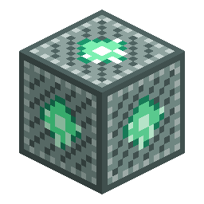

# Nucleo del villaggio

> Questa pagina è una bozza tradotta automaticamente; fa fede la versione inglese: [English](../../Village-Core.md).

<!-- nerospace:render -->

<!-- /nerospace:render -->

Il blocco di controllo al cuore di un villaggio alieno: rivendicalo, riforniscilo e insegna al villaggio a costruirsi da solo.

## Panoramica

Il **Nucleo del villaggio** è il centro del sistema dei villaggi alieni: memorizza il proprietario, una scorta di materiali da costruzione, la coda di costruzione, la produzione passiva e la missione attuale. Compare nelle **[strutture](Alien-Structures.md)** generate e si può piazzare a mano.

## Come ottenerlo

- Si trova al centro di ogni **[borgo, rovina e megalopoli](Alien-Structures.md)**.
- Disponibile nella scheda creativa di Nerospace.

## Rivendicare e far crescere un villaggio

1. **Rivendica**: fai clic destro su un nucleo non rivendicato per diventarne il proprietario.
2. **Riforniscilo**: fai clic destro con un **Blocco di Nerosteel** per riempire la scorta di costruzione.
3. **Insegna il prossimo edificio**: fai clic destro come proprietario. Se i **[villici](Alien-Villagers.md)** vicini

   si fidano abbastanza di te *e* la scorta ha i materiali, il nucleo impegna il costo e inizia a costruire.

4. **Guardalo crescere**: l'edificio viene piazzato **blocco per blocco in tempo reale** con delle particelle.

   Fai di nuovo clic destro per leggere la percentuale di avanzamento.

Il nucleo considera come tua posizione il **livello di reputazione più alto tra i villici vicini**, quindi è commerciando con la gente del posto che si sblocca l'insegnamento.

### Catalogo degli edifici

| Edificio | Requisito | Costo |
| --- | --- | --- |
| Capanna | livello di fiducia 2 | 32 Nerosteel |
| Laboratorio | livello di fiducia 3 | 48 Nerosteel |

Gli edifici vengono insegnati in ordine man mano che il villaggio cresce.

## Villaggio funzionante

Una volta che esistono degli edifici, il nucleo diventa un piccolo motore:

- **Produzione**: gli edifici completati producono periodicamente beni (Capanna → pane, Laboratorio → Nerosteel).

  **Clic destro da accovacciato** sul nucleo per raccogliere la produzione e leggere il compito attuale.

- **Missioni**: il villaggio pubblica un compito di raccolta (per esempio *porta 8 quarzo Xertz*). Fai clic destro sul nucleo con

  l'oggetto richiesto per consegnarlo in cambio di **smeraldi + un aumento di fiducia per tutto il villaggio**; poi ne arriva uno nuovo.

- **Incursioni**: di notte, i villaggi rivendicati vicino a un giocatore subiscono di tanto in tanto incursioni di creature ostili.

  Si attivano o disattivano con `alienRaidsEnabled` (vedi **[Configurazione](Configuration.md)**).

## Interazioni in sintesi

| Azione | Risultato |
| --- | --- |
| Clic destro (mano vuota, non rivendicato) | Rivendica il villaggio |
| Clic destro con un Blocco di Nerosteel | Deposita nella scorta di costruzione |
| Clic destro (proprietario, mano vuota) | Insegna/costruisci il prossimo edificio, o leggi l'avanzamento |
| Clic destro da accovacciato | Raccogli la produzione + leggi la missione attuale |
| Clic destro con l'oggetto della missione | Consegna la missione in cambio di smeraldi + fiducia |

## Dettagli

- ID: `nerospace:village_core` · attrezzo piccone · drop se stesso
- Salva proprietario, scorta, numero di edifici costruiti, il lavoro di costruzione attivo, le riserve di produzione e la missione attuale.
