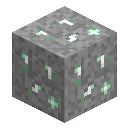

# Minerale di quarzo Xertz

> Questa pagina è una bozza tradotta automaticamente; fa fede la versione inglese: [English](../../Xertz-Quartz-Ore.md).

<!-- nerospace:render -->

<!-- /nerospace:render -->

Un minerale cristallino verde pallido su **Greenxertz**, l'equivalente del quarzo del Nether in questa mod.

## Panoramica

Il quarzo Xertz si comporta come il quarzo del Nether: il minerale lascia cadere la gemma **direttamente** (senza fusione) ed è abbondante. È una gemma da fabbricazione per pannelli solari, filtri per tubi e potenziamenti.

## Come ottenerlo

- **Estrazione:** va bene qualsiasi piccone. Lascia cadere direttamente **quarzo Xertz** (influenzato da Fortuna). Se preferisci, il minerale si può anche

  fondere in quarzo Xertz. Il [Macinatore di Nerosium](Nerosium-Grinder.md) trasforma 1 minerale in **2 quarzo Xertz**.

- **Generazione:** compare in abbondanza in tutta la dimensione **Greenxertz**, in modo uniforme circa tra

  **y 0 e y 110**.

## Utilizzo

- Fabbrica il **[Pannello solare](Solar-Panel.md)** (livello 1), il **[Monitor di terraformazione](Terraform-Monitor.md)**,

  il **Filtro per tubi avanzato** e il **Potenziamento di capacità** (vedi [Filtri per tubi e potenziamenti](Pipe-Filters-and-Upgrades.md)).

- Nota: la **[Tanica di carburante per razzi](Items.md#rockets--fuel)** **non** usa il quarzo Xertz. Si fa con polvere di blaze + carbone + lingotto di ferro.

## Dettagli

- ID: `nerospace:xertz_quartz_ore` · Dimensione: Greenxertz
- Attrezzo: qualsiasi piccone · Drop: quarzo Xertz (gemma)
