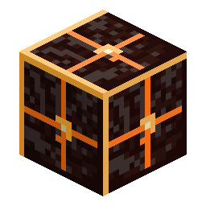

# Cindrite块

> 本页为机器翻译草稿，仅供参考，以英文版本为准：[English](../../Block-of-Cindrite.md)。

<!-- nerospace:render -->

<!-- /nerospace:render -->

九颗 Cindrite 宝石的紧凑存储方式。

## 概述

由 Cindara 水晶制成的发光余烬色存储方块。

## 获取方式

- **合成：**用 **Cindrite** 填满 3×3 网格。
- **拆解：**单独合成该方块即可取回 **9 个 Cindrite**。

## 详细信息

- ID：`nerospace:cindrite_block`
- 工具：镐，铁级 · 掉落：自身
