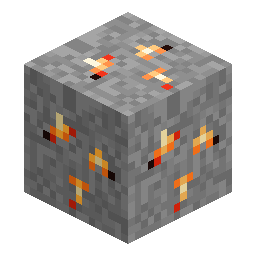

# Cindrite矿石

> 本页为机器翻译草稿，仅供参考，以英文版本为准：[English](../../Cindrite-Ore.md)。

<!-- nerospace:render -->

<!-- /nerospace:render -->

火山卫星 **Cindara** 的标志性水晶。

## 概述

Cindrite 是一种发光的余烬色宝石，只在 Cindara 上出现。它比 Greenxertz 的矿石更稀有，埋藏也更深，是对前往本模组中最恶劣世界的奖励。

## 获取方式

- **挖掘：**需要**铁级镐**或更好的镐。直接掉落 **Cindrite** 宝石

  （受时运影响）。

- **生成：**在 **Cindara** 维度中生成，分布在大约 **y −48 到 y 48** 的三角形区间内——

  比 Greenxertz 的矿石更稀有。

## 用途

- 打包成 **[Cindrite块](Block-of-Cindrite.md)** 用于存储。
- 将 **[地形改造器](Terraformer.md)** 升级到 **3 级**（把一个 Cindrite 放入其升级槽）。
- 合成 **2 级**和**耐热**[氧气服](Oxygen-Suit.md)部件（每件 4 个 Cindrite）。
- **4 级火箭**配方的一部分。

## 详细信息

- ID：`nerospace:cindrite_ore` · 维度：Cindara
- 工具：镐，铁级 · 掉落：Cindrite（宝石）
