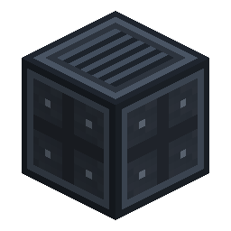

# 发射控制器

> 本页为机器翻译草稿，仅供参考，以英文版本为准：[English](../../Launch-Controller.md)。

<!-- nerospace:render -->
<p align="right"></p>
<!-- /nerospace:render -->

一台能建造发射台并驾驶火箭的任务控制台。

## 概述

发射控制器是一台实心的 **3 格宽 × 2 格高**控制台——深炮铜色机身，配有发光的动态“电脑大脑”面板（实时屏幕、投影臂和脉动光带）。一个方块完成两项工作：用装载的材料**建造**发射台，以及为停在该发射台上的火箭**加注燃料并发射**。将它朝向一片空地放置；它会建造并管理前方的发射台。

## 获取方式

**合成**（有序）：

```text
W R W
P C P
W R W
```

`W` = [空间站墙壁](Station-Wall.md) · `P` = [火箭发射台](Rocket-Launch-Pad.md) ·
`R` = 红石 · `C` = 红石比较器

放置时会形成完整的 3×2 结构（需要足够的空间——如果被阻挡，放置会被取消）。破坏任何部分都会移除整个控制台并掉落一个控制器。

## 工作原理

界面有两种模式（在右上角切换）：

**建造模式**

- 将建筑方块装入三个槽位：**发射台**、**空间站墙壁**、**发射塔架**。
- 选择目标**等级（T1–T4）**。占地随等级增大——T1 单个发射台，T2 一个 3×3，T3 一个由空间站墙壁围绕的 3×3，T4 一个带塔架的重型发射综合设施。
- **切换全息投影**会从控制台的投影臂投射出仍需放置的*实际方块*的虚影。
- **建造发射台**以**累加**方式在世界中铺设结构——将已有的低等级发射台升级为更高等级而无需拆除。它只会放置你已装载的方块。
- 实时读数显示仍需多少发射台／墙壁／塔架，以及控制器机载的**燃料／O₂／电力**水平。

**发射模式**

- 控制器携带机载的**燃料**、**氧气**和**电力**缓存——通过[通用管道](Universal-Pipe.md)（流体／气体／能量层）为其供给。它会将这些泵入停靠在发射台上的火箭。
- 读取所停靠火箭的燃料／氧气／电力，选择其目的地，然后直接从控制台**发射**（火箭起飞时你会登舱）。

## 详细信息

- ID：`nerospace:launch_controller`
- 一个 3×2 多方块结构；填充方块是实心的（你无法穿过控制台）。
- 能力（流体／气体／能量）暴露在核心方块上，供管道自动化使用。
