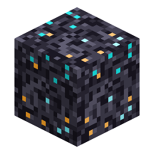

# 陨石岩

> 本页为机器翻译草稿，仅供参考，以英文版本为准：[English](../../Meteor-Rock.md)。

<!-- nerospace:render -->

<!-- /nerospace:render -->

陨石坠落后留下的焦黑、微微发光的岩石。

## 概述

陨石岩构成坠落陨石周围的小型陨石坑（参见 **[陨石事件](Meteor-Events.md)**）。它是一种装饰性的太空岩石建筑方块——带有青色／蓝绿色外星光纹的深色玄武岩——也是远处可见的坠落地点标志。

## 获取方式

- **挖掘：**任何镐均可；需要正确的工具才会掉落。掉落自身，因此你可以收集它并

  用于建筑。

- **生成：**由陨石撞击放置——在正常世界生成中不会出现。

## 用途

- 用于太空／陨石坑建筑的装饰方块。
- **[陨石核心](Meteor-Core.md)**周围的陨石坑主体——挖进去即可拿到战利品。
- 在 **[Nerosium研磨机](Nerosium-Grinder.md#grinding-meteor-rock--random-space-materials)** 中**研磨**它，可从 **[Neroland Core](Neroland-Core.md)** 的陨石材料注册表中获得一种按权重随机的太空材料——受进度门槛限制，并偏向你进行研磨时所在的行星。

## 详细信息

- ID：`nerospace:meteor_rock` · 工具：镐 · 掉落：自身
- 发出微弱的光（亮度 3）。
