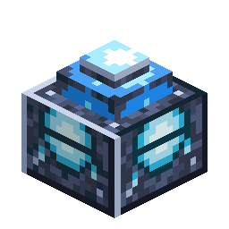

# 氧气发生器

> 本页为机器翻译草稿，仅供参考，以英文版本为准：[English](../../Oxygen-Generator.md)。

<!-- nerospace:render -->
<p align="right"></p>
<!-- /nerospace:render -->

将电网电力转化为氧气，并为周围的空气加压，让你在外星世界存活。

## 概述

每个 Nerospace 维度都**没有空气**——暴露在外的玩家会失去氧气并窒息。氧气发生器是一台**电解机器**：它消耗管道网络中的能量，并将**氧气**产出到内部储罐中。该储罐既为机器周围的可呼吸区域供氧，也可以通过通用管道（气体层）**输出**到气体储罐或其他房间。

## 获取方式

**合成**（有序）：

```text
N G N
R C R
N N N
```

`N` = Nerosteel锭 · `G` = 玻璃 · `R` = 红石 · `C` = 火箭燃料罐

## 工作原理

- **电力输入：**连接一条输送能量的通用管道（来自燃烧／被动发电机或

  电池）。机器最多可储存 **50,000 FE**，每刻最多接收 **1,000 FE**。它不能直接燃烧
  燃料——只能使用电网电力。

- **氧气输出：**通电时，它以**每 mB 20 FE**（生产时 80 FE/t）的代价**每刻产出 4 mB 氧气**，

  存入 8,000 mB 的内部储罐。与之相连的管道可以将气体运走（青色气流）。

- **氧气区域：**只要储罐中有气体，机器就是一个氧气**源**，会缓慢消耗

  （2 mB/t）以维持空气。空气会通过相连的开放空间向外扩散：

  - **密封房间**（墙壁／屋顶——完整方块和玻璃都是气密的）：**整个房间都会充满**氧气，

    并保持可呼吸。

  - **开放／漏气的空间：**只有发生器周围的一个气泡会被加压（空气会从任何

    开口逸出），因此请密封你的基地以实现完全覆盖。门或缝隙都算作漏气。

  - 覆盖范围最多可达发生器周围相连空气中的 16 格。在开放空间中，气泡半径约为 14 格。这些数值是固定的。
- **流失：**如果储罐耗尽或机器被破坏，氧气会**在约 10 秒内

  消散**。

- **红石关闭开关：**发生器旁的红石信号会将其关闭，其空气气泡

  随之消失。

- **HUD：**在没有空气的维度中，快捷栏上方会出现一条青色的 **O₂ 条**（氧气不足时变红）。
- **气闸：**在 **4 格**范围内穿着全套[氧气服](Oxygen-Suit.md)的玩家

  会直接从机器的储罐为氧气服补充空气，消耗其中的气体——即使房间本身还不可呼吸，放在基地门口也很方便。

- **自动化：**根据其氧气储罐的储量发出**比较器信号**。

## 提示

建造一个气密房间，把电线接到房间内的发生器上，只要电网正常，房间就会保持可呼吸。将多余的氧气通过管道输入**气体储罐**，作为停电时的缓冲。全套**氧气服**是在远离发生器的地方探索时的便携替代方案。

## 详细信息

- ID：`nerospace:oxygen_generator` · 工具：镐，铁级 · 掉落：自身
- 界面：电量表 + 氧气储罐表，并显示“生产中／无电力”状态
- 气泡半径（14）、漏气范围（16 格）、消散时间（10 秒）、可呼吸阈值（6）和气闸半径（4）都是固定的，不是配置键。可调整的内容参见[配置](Configuration.md)。
