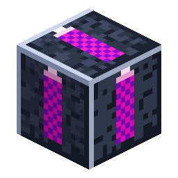

# 采石场标记

> 本页为机器翻译草稿，仅供参考，以英文版本为准：[English](../../Quarry-Landmark.md)。

<!-- nerospace:render -->
<p align="right"></p>
<!-- /nerospace:render -->

用于界定[采石场控制器](Quarry-Controller.md)挖掘区域的角落标记。

## 概述

标记是你划定采石场范围的方式。每个标记都会沿水平轴投射动态的**标记激光**；**以 L 形放置三个**，控制器就会将它们读取为矩形的角。采石场启动时它们会被消耗。

> 标记是可选的：你也可以用手动放置的**框架方块**（框架外壳可以放置）自己勾勒出矩形，然后把控制器放在闭合的框架旁边——参见[采石场控制器](Quarry-Controller.md)。

## 获取方式

**合成**（有序，产出 3 个）：

```text
R
G
I
```

`R` = 红石 · `G` = 玻璃 · `I` = [Nerosteel锭](Items.md)

## 工作原理

- **三个标记 = 一个矩形。**两个标记在范围内处于同一 Y 高度的同一行或同一列时会“连接”；

  L 形的三个标记给出矩形的全部四条边界。

- **相同的 Y 高度。**将三个标记都放在同一高度——该高度会成为采石场的参考

  平面（框架建在那里；挖掘从其正下方一直进行到基岩）。

- **在尺寸上限之内。**矩形的每条边最长可达 **64 格**（

  `quarryMaxSide` 配置值）。过大或退化的布局根本不会被认领——控制器会保持在“空闲——请设置标记或框架”状态。

- **绑定。**将[采石场控制器](Quarry-Controller.md)放在某个标记旁边／与其对齐。

  启动时，它会扫描这组标记，**移除标记方块**，并建造框架。

- **除此之外仅为装饰**——激光是客户端效果；标记没有物品栏，也不需要

  电力。

## 详细信息

- ID：`nerospace:quarry_landmark` · 工具：任何工具或空手 · 掉落：自身
- 分步讲解参见[采石场设置指南](Quarry-Setup-Guide.md)，完整参考参见[采石场控制器](Quarry-Controller.md)。
