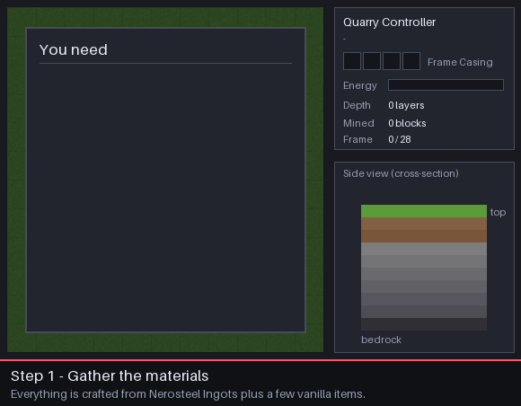

# 采石场设置指南

> 本页为机器翻译草稿，仅供参考，以英文版本为准：[English](../../Quarry-Setup-Guide.md)。

<!-- nerospace:render -->
<p align="right"></p>
<!-- /nerospace:render -->

让你的第一台[采石场控制器](Quarry-Controller.md)开始挖掘的分步讲解——从合成部件到收集矿石。完整参考（每条状态信息、框架损坏、区块加载、等级）请参阅[采石场控制器](Quarry-Controller.md)页面。

## 速览



1. 合成部件：一个控制器、标记（或额外的外壳）、框架外壳和一个箱子。
2. 用 **3 个[采石场标记](Quarry-Landmark.md)**以 L 形标出一个矩形，全部位于同一高度。
3. 将**控制器**放在相同高度，紧挨矩形的某一边。
4. 将**框架外壳**装入控制器——它会建造框架。
5. 连接**电力**和**输出箱子**——它会一直挖到基岩并装满箱子。

## 1. 收集材料

所有东西都由 **[Nerosteel锭](Items.md)**（来自 Greenxertz 上的 Nerosteel矿石）加上少量原版物品制成。

| 部件 | 配方 | 你需要 |
| --- | --- | --- |
| [采石场控制器](Quarry-Controller.md) | 5 个Nerosteel锭、1 颗钻石、2 个框架外壳、1 个红石块 | 1 |
| [采石场标记](Quarry-Landmark.md) | 红石放在玻璃上，玻璃放在 Nerosteel锭上——产出 **3** 个 | 3（合成一次） |
| [框架外壳](Upgrade-Modules.md) | 8 个Nerosteel锭围成一圈——产出 **4** 个 | 见下表 |
| 电源 | 例如[燃烧发电机](Combustion-Generator.md)或[被动发电机](Passive-Generator.md)，外加[通用管道](Universal-Pipe.md) | 1 |
| 输出存储 | 一个箱子（或一条通往你的存储的管道） | 1 |

**需要多少框架外壳？**框架是围绕矩形的一圈：每个周边方块一个外壳，即 `2 × width + 2 × length − 4`（如果控制器就位于框架环上，则少一个）。

| 区域（标记到标记） | 每层挖掘的方块 | 外壳 | 外壳所需 Nerosteel |
| --- | --- | --- | --- |
| 8 × 8 | 6 × 6 | 28 | 56 |
| 16 × 16 | 14 × 14 | 60 | 120 |
| 32 × 32 | 30 × 30 | 124 | 248 |
| 64 × 64（最大） | 62 × 62 | 252 | 504 |

> **提示：**控制器有 4 个外壳槽位（256 个外壳），足够建造最大的框架——而且挖掘完成后每个外壳都会返还给你，因此你的第一套外壳可以重复使用。

## 2. 选择位置

- **行星：**目前的控制器是 **1 级**。它可以在**主世界**、**Greenxertz** 和**轨道空间站**上工作。在 **Cindara** 和 **Glacira** 上它会显示*已暂停——行星错误*（适用于这些卫星的更高等级控制器正在计划中）。
- **高度：**你放置标记的高度就是**框架高度**。采石场会挖掘该高度及其**以下的所有东西**，一直到基岩。它**上方**的任何东西（树木、山丘、你的房子）都不会被动——因此请在地面高度放置标记，或者先挖出一块平地。
- **尺寸：**每条边可以是 **3 到 64 格**长，从标记量到标记（服务器可以用 `quarryMaxSide` 降低上限——参见[配置](Configuration.md)）。外圈会成为框架，因此只有**内部**会被挖掘。
- **清空框架环：**框架环上的方块会被框架**替换**（不会掉落），因此不要在上面放任何你想保留的东西。框架环上的箱子和机器会保留原位，而区域*内部*任何带方块实体的东西，其整列都不会被挖掘。

## 3. 放置标记

以 **L 形放置三个标记**，**全部位于同一 Y 高度**：

- 一个放在**角**上，
- 一个沿 **X**（东／西）方向与其成一直线，
- 一个沿 **Z**（南／北）方向与其成一直线。

这三个标记给出了矩形的四条边——不需要第四个。

```text
  L . . . . . . . L        L = Quarry Landmark
  .               .        . = frame ring (built for you)
  .   mined area  .        C = Quarry Controller
  .               .
  L . . . . . . . . C      <- the controller sits right beside a side,
                              in line with it, at the same Y
```

标记会沿着各自的轴线在地面上投射标记激光，让你在继续之前可以轻松地将三个标记对齐。

## 4. 放置控制器

将**采石场控制器**放在与标记**相同的 Y 高度**，**紧挨矩形的某一边**（接触边缘——而不是斜对着角）。你也可以把它放在**框架环上**——此时它会占据该框架方块的位置。

片刻之后，控制器会找到这些标记并**认领该区域**。标记会被**消耗**（消失），状态会从*空闲*变为*已暂停——框架外壳耗尽*或*正在建造框架*。

> **仍然显示“空闲——请设置标记或框架”？**检查控制器和三个标记是否位于同一 Y 高度、控制器是否接触某一边（而不是角），以及是否没有任何一边超过 64 格（或你服务器的 `quarryMaxSide`）。

### 替代方案：不用标记

框架外壳可以放置。你可以不用标记，而是在同一高度建造一个**完整、闭合的矩形框架方块环**（没有空缺，没有多余的方块伸出），然后将控制器放在它旁边。控制器会接管你的框架环并立即开始采矿，跳过建造框架的步骤。

## 5. 装入框架外壳

右键点击控制器，将**框架外壳**放入界面**左上方的四个槽位**（对准控制器的漏斗或管道也可以）。它会沿着框架环每半秒放置一个框架方块。框架环完成后，状态会变为**采矿中**。

## 6. 连接电力

采矿**每个方块消耗 40 FE**（框架本身是免费的）。控制器可容纳 200,000 FE，并可从**任意一面**接收能量——从发电机或[电池](Battery.md)接一条[通用管道](Universal-Pipe.md)，或者将发电机直接贴在它旁边。来自其他模组的管道和发电机的能量也可以使用。

没有模块的 1 级采石场每秒约挖掘 **4 个方块**，约消耗 **8 FE/t**——一台[燃烧发电机](Combustion-Generator.md)（20 FE/t）甚至一台[被动发电机](Passive-Generator.md)（8 FE/t）就能让它保持运转。如果电力耗尽，它会显示*已暂停——电力不足*，并在能量到来后自行继续。

## 7. 收集产出

挖到的物品会进入控制器的 **12 格输出缓存**，并会被**自动推送到任何与控制器接触的箱子或物品栏**（或由管道抽出）。如果全部满了，它会显示*已暂停——输出缓存已满*——**绝不会扔掉任何东西**；清空箱子后它就会继续。

**液体：**区域中的水源和熔岩源方块会被吸入一个 16,000 mB 的储罐，然后推送到相接触的[流体储罐](Fluid-Tank.md)或管道中。放不下的液体会被销毁，因此挖掘永远不会停滞。一点都不想要？安装一个**蒸发模块**（见下文）。

一个不错的起步布局是：控制器，一面贴箱子，另一面接电力管道——然后就可以走开了。

## 8. 可选：升级模块

1 级控制器有**一个模块槽位**（位于外壳槽位右侧）。选择一个：

| 模块 | 效果 |
| --- | --- |
| **速度** | 挖掘速度 +50% |
| **效率** | 每个方块能量 −15% |
| **时运** | 对挖掘的每个方块应用时运（更多矿石掉落） |
| **精准采集** | 矿石和方块掉落其自身 |
| **蒸发** | 销毁液体而不是储存它们 |

配方见[升级模块](Upgrade-Modules.md)页面。

## 9. 完成时

采石场会逐层挖掘，直到到达基岩（它会跳过基岩和其他任何无法破坏的东西）。然后它会显示**已完成——框架已回收**：框架会被拆除，**每个外壳都会返还**到控制器中，为下一个地点做好准备。破坏控制器——它会掉落自身以及外壳、模块和任何缓存的物品——然后在新的地方重新设置。

> **想在挖掘途中搬走？**在完成之前破坏控制器会留下框架；这些框架方块会在几分钟内崩解，每个都会掉落其外壳。在那之前把控制器放回框架环旁边，它就会继续挖掘。

## 故障排除

| 状态 | 解决方法 |
| --- | --- |
| **空闲——请设置标记或框架** | 标记或控制器高度不同、控制器没有接触某一边、某一边超过尺寸上限，或 L 形只有两个标记。 |
| **已暂停——框架外壳耗尽** | 向左上方槽位添加更多框架外壳。 |
| **已暂停——框架不完整** | 某个框架方块被破坏了。添加外壳（它会重建缺口），或者自己在缺口处放置一个外壳。 |
| **已暂停——电力不足** | 连接或添加发电机／电池。 |
| **已暂停——输出缓存已满** | 在控制器旁边放一个箱子，或清空已有的箱子。 |
| **已暂停——行星错误** | 1 级无法在 Cindara 或 Glacira 上采矿。 |

## 另请参阅

[采石场控制器](Quarry-Controller.md) · [采石场标记](Quarry-Landmark.md) · [升级模块](Upgrade-Modules.md) · [通用管道](Universal-Pipe.md) · [配置](Configuration.md)

<!-- Blank Commit Spot -->
