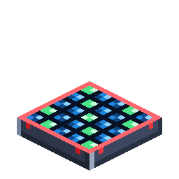

# 太阳能板

> 本页为机器翻译草稿，仅供参考，以英文版本为准：[English](../../Solar-Panel.md)。

<!-- nerospace:render -->
<p align="right"></p>
<!-- /nerospace:render -->

追踪太阳的发电设备，会与相邻的太阳能板合并为一个大型太阳能阵列。共有**三个等级**——1 级是单个方块；2 级和 3 级是 2×2 和 3×3 的**多方块结构**，只需放置一个物品即可。

## 获取方式

**1 级**（有序）：玻璃面板覆盖在石英／铜电池上，底部是 Nerosteel 外壳——

```text
G G G
Q C Q
N N N
```

`G` = 玻璃 · `Q` = Xertz石英 · `C` = 铜锭 · `N` = Nerosteel锭

**2 级**——四块 1 级太阳能板围绕一个 Nerosium块：

```text
. P .
P N P
. P .
```

`P` = 1 级太阳能板 · `N` = Nerosium块

**3 级**——四块 2 级太阳能板围绕一个金块：

```text
. Q .
Q G Q
. Q .
```

`Q` = 2 级太阳能板 · `G` = 金块

每一级的配方都包含**上一级太阳能板**，因此升级时可以复用你已经造好的东西。

## 工作原理

- **阳光进，FE 出。**产出随太阳变化：正午最高，到**夜晚降为零**。

  在普通维度中，太阳能板需要**能直接看到天空**——正上方有任何实心方块都会
  停止发电。

- **天气：**没有固定的雨天或雷暴惩罚。产出取决于天空的暗度：

  产出 × (10 − 天空暗度) / 10。下雨和暴风雨会使天空变暗，因此产出随之下降。

- **无空气维度**（轨道空间站、Greenxertz、Cindara、Glacira、玩家建立的空间站）拥有

  永久的阳光，因此那里的太阳能板以满功率运行，**并获得 ×2 加成**。在那里它们也**不**需要
  看到天空。太阳能是外星世界天然的电力来源。

- 产出和储存随等级缩放（所有数值 × `energyRateMultiplier` 配置）。缓存

  从不接受外部推送。

- **自动推送：**太阳能板会向任何与之接触的机器或电池推送电力。

| 等级 | 占地 | 正午产出 | 储存 |
| --- | --- | --- | --- |
| **1 级** | 1×1 | 20 FE/t | 50,000 FE |
| **2 级** | 2×2 | 100 FE/t | 250,000 FE |
| **3 级** | 3×3 | 400 FE/t | 1,000,000 FE |

每个更高等级的**单位面积**发电量都比铺设低一级的太阳能板更强，并且拥有大得多的缓存。

### 多方块结构（2 级和 3 级）

- 2 级／3 级太阳能板是一个**放置后会占满其整个 N×N 范围的单一物品**——你需要

  清空那片平地（如果范围内有阻挡，它将无法放置）。

- 它作为**一个整体**运作：一块大型倾斜面板、一个共享缓存，每个外侧面都有能量。
- **破坏任何一格都会以一个物品的形式返还整块太阳能板**——不会复制，无论你在哪里挖掘，

  都能拿回你的太阳能板。

### 阵列

- 将同等级的单元**彼此相邻**放置，它们会自动合并为一个**阵列**：

  阵列的储存是**所有单元缓存之和**，其发电量是**所有单元产出之和**。建得越宽，两者就越多——阵列几乎可以是任何尺寸。

- **每一面都是输出端口。**一条通用管道（能量层）——或任何机器／电池——接触

  *任意*一面，都会从共享阵列池中取电，因此一条管道就能抽取整个阵列的电力。

- **等级永不混合。**并排放置的 1 级阵列和 2 级阵列会保持独立；只有*同一*等级的单元

  才会合并。

### 外观

各等级**外观明显不同**——1 级带有绿色点缀，安装在 **T 形支柱**上转动，从东到西追踪太阳；2 级（Nerosium 品红色）和 3 级（金色）是平铺的 N×N 阵列，其面板**白天向上倾斜朝向天空，夜晚折叠平放在外壳上**。所有太阳能板读取相同的世界时间，因此一整片太阳能板会同步运动。

## 详细信息

- ID：`nerospace:solar_panel`（1 级）／`nerospace:solar_panel_t2`／`nerospace:solar_panel_t3`
- 工具：1 级需要铁镐；2 级和 3 级任何镐均可。
- 1 级掉落自身；2／3 级在任何一格被破坏时，为整个多方块结构返还一个物品。
- 根据阵列的电量发出比较器信号。
- 配置：`energyRateMultiplier`（同时缩放产出和储存）。参见**[配置](Configuration.md)**。
