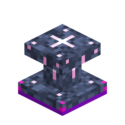

# 星际指南

> 本页为机器翻译草稿，仅供参考，以英文版本为准：[English](../../Star-Guide.md)。

<!-- nerospace:render -->
<p align="right"></p>
<!-- /nerospace:render -->

游戏内进度指南——一个展台、一本书和一棵实时任务树。

## 概述

星际指南是 Nerospace 内置的教程和进度追踪器：一棵包含 **10 个章节、45 个步骤**的交互式任务树，从你的第一块 Nerosium 矿石一直到自动化的星际补给线。完成情况通过本模组的**进度树**按玩家追踪，因此指南始终是实时的——无论在哪里完成某件事，任务树都会亮起。

## 获取方式

**星际指南书**（无序）：**书 + 粗Nerosium**——开局几分钟即可获得。也可以用 **Nerosium矿石**或**深层Nerosium矿石**方块代替粗Nerosium。

**星际指南**展台（有序）：

```text
. R .
. P .
S S S
```

`R` = 粗Nerosium（或一个 Nerosium矿石方块） · `P` = 任意木板 · `S` = 圆石

## 工作原理

- **随处阅读：**手持**星际指南书**右键点击即可打开指南界面。
- **展台：**手持书右键点击空展台即可将书放上（类似讲台；破坏

  展台或潜行右键点击会将书弹出）。放有书的展台会投射一个旋转的**下一目标全息影像**，右键点击它会打开相同的界面。

- **任务树：**各章节涵盖 **Nerosium → 机器 → 电网 → 火箭技术 → 新世界 →

  [采矿](Quarry-Controller.md) → 真空求生 → 地形改造 → 陨石事件 →
  [货运](Cargo-Pad.md)**。已完成的步骤会闪烁；每个步骤
  都附有指南文字，准确告诉你下一步该做什么。

- **采矿章节：**采石场自动化路线——[采石场标记](Quarry-Landmark.md) →

  [框架外壳](Upgrade-Modules.md) → [采石场控制器](Quarry-Controller.md) →
  [升级模块](Upgrade-Modules.md)。需要 Nerosteel（Greenxertz）才能解锁，因为框架由它建造。

- **比较器：**放有书时展台会发出信号。

## 详细信息

- ID：`nerospace:star_guide`（方块） · `nerospace:star_guide_book`（物品）
