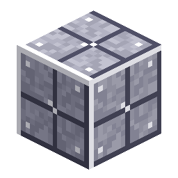

# 空间站地板

> 本页为机器翻译草稿，仅供参考，以英文版本为准：[English](../../Station-Floor.md)。

<!-- nerospace:render -->

<!-- /nerospace:render -->

用于扩建轨道空间站的金属平台镀板。

## 概述

**轨道空间站**的抵达平台由空间站地板构成，你可以合成更多来扩建你在轨道上（以及其他任何地方）的基地。这是一种坚固、抗爆的装饰／建筑方块。

## 获取方式

- **合成：** **8 个Nerosteel锭**围绕一个**平滑石头**中心 → **8 个空间站地板**。（中心的材料很重要：同样的一圈若中心*留空*，得到的是采石场的[框架外壳](Upgrade-Modules.md)；若中心放*铁锭*，得到的是[空间站墙壁](Station-Wall.md)。）
- 空间站的初始平台会在首次抵达时自动生成（单个共享

  平台——参见[火箭发射台](Rocket-Launch-Pad.md)／路线图）。

## 详细信息

- ID：`nerospace:station_floor`
- 工具：镐，铁级 · 掉落：自身 · 高爆炸抗性
