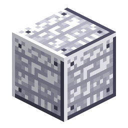

# 空间站墙壁

> 本页为机器翻译草稿，仅供参考，以英文版本为准：[English](../../Station-Wall.md)。

<!-- nerospace:render -->

<!-- /nerospace:render -->

轨道空间站的船体护板——同时也是 3 级进度门槛。

## 概述

空间站墙壁是空间站的墙体／船体方块。由于它由空间站级材料合成，它也**限制了 3 级火箭**：你必须先抵达轨道空间站（1 级）并建造空间站船体，才能合成 3 级火箭。

## 获取方式

- **合成：** **8 个Nerosteel锭**围绕一个**铁锭**核心 → **8 个空间站墙壁**。

## 用途

- 建造／密封加压房间——与所有完整不透明方块一样，它是**气密的**，可作为

  氧气密封（参见[氧气发生器](Oxygen-Generator.md)）。

- **3 级火箭**配方所需。
- **围绕 3×3 [发射台](Rocket-Launch-Pad.md)一圈**（发射台高度上的 16 格边框）是部署 3 级火箭的

  两种方式之一——另一种是[重型发射综合设施](Launch-Gantry.md)。

- **[空间站章程](Station-Charter.md)**和

  **[发射塔架](Launch-Gantry.md)**的材料。

## 详细信息

- ID：`nerospace:station_wall`
- 工具：镐，铁级 · 掉落：自身 · 高爆炸抗性
