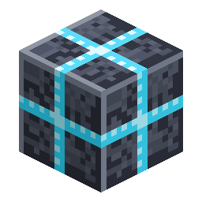

# 通用管道

> 本页为机器翻译草稿，仅供参考，以英文版本为准：[English](../../Universal-Pipe.md)。

<!-- nerospace:render -->
<p align="right"></p>
<!-- /nerospace:render -->

一根管道搞定一切：能量、流体、气体和物品在同一根半透明管道中流动——而且是同时流动。

## 概述

通用管道是 Nerospace 物流的支柱。放置的管道会自动相互连接，并连接到任何机器、储罐或物品栏，形成一个作为整体共享系统运作的**网络**。全部四个资源层同时沿着同一张连接图运行：

| 层 | 颜色 | 规则 |
| --- | --- | --- |
| 能量（FE） | 红色 | 共享池，在所有管段之间平衡 |
| 流体 | 蓝色 | **每个网络一种流体**——第一种进入的流体会占据网络，直到被抽空 |
| 气体 | 青色（氧气）、淡蓝色（氢气）、灰色（其他气体） | 每个网络一种气体；**破坏管道会释放其中的气体**（可见的烟雾） |
| 物品 | — | 以**可见的包裹**形式移动（约 2.5 格/秒），在各目的地之间轮流分配 |

## 获取方式

**合成**（有序，产出 8 个）：Nerosteel 外壳包裹玻璃芯——

```text
N N N
N G N
N N N
```

`N` = Nerosteel锭 · `G` = 玻璃

## 工作原理

- **连接：**管道会向任何能与之交互的东西（管道、机器、储罐、

  箱子）伸出一条连接臂。每个面都有**按层**独立的输入／输出模式：自动 → 输入 → 输出 → 关闭（用
  [配置器](Configurator.md)设定）。这包括[电池](Battery.md)、[流体储罐](Fluid-Tank.md)、
  [气体储罐](Gas-Tank.md)、[物品存储器](Item-Store.md)以及虚空汇[垃圾桶](Trash-Can.md)——它们
  现在都由 [Neroland Core](Neroland-Core.md) 提供；管道将 Core 的
  `nerolandcore:fluid`（以及能量／物品）能力桥接到自身的查找上，因此连接方式
  与以前完全相同（将一个**输出**面对准垃圾桶即可倾倒一股物流）。

- **能量／流体／气体：**网络从提供方抽取，向接收方推送，并平衡自身的

  缓存——彩色脉冲流显示什么正在流向哪里。每层可容纳 **8,000**（FE 或 mB），
  每刻最多传输 **1,000**。

- **物品：**抽取面会从物品栏中提取物品；包裹在管道中实际移动，

  在交叉口重新规划路线，并且**永不溢出**——如果所有目的地都满了，它们会停下等待。
  物品每格移动需要 **8 刻**（约每秒 2.5 格）。一个抽取面**每 4 刻提取
  16 个物品**。
  破坏管道会掉落其中的物品。

- **过滤器与升级：**参见[管道过滤器与升级](Pipe-Filters-and-Upgrades.md)。
- **读数：**空手右键点击管道可查看其当前内容；空手潜行右键点击

  可弹出已安装的升级。

## 其他模组的管道和机器

管道并不局限于 Nerospace 方块。现在，它在每个加载器上都会同时提供并读取平台的标准流体和物品处理器——也就是更广泛的科技模组生态所使用的那些——因此 Nerospace 的管线和其他模组的物流可以在中间相接：

- **流体：** **输出**面会推送到其他模组的储罐或流体机器中，**输入**面会从中抽取，

  而其他模组的流体管道可以独立地抽取或注入 Nerospace 的[流体储罐](Fluid-Tank.md)、
  [燃料储罐](Fuel-Tank.md)、[燃料精炼厂](Fuel-Refinery.md)、[采石场控制器](Quarry-Controller.md)、
  [发射控制器](Launch-Controller.md)或通用管道——整条管线中
  完全不需要 Nerospace 管道。

- **物品：**同样双向适用于其他模组的机器、板条箱和物品管道。
- **能量**早已通过 [Neroland Core](Neroland-Core.md) 的共享网络跨越了模组边界。
- **气体**通过 Neroland Core 的共享气体能力在 Neroland 模组之间流通

  （`nerolandcore:gas`）。气体层可输送任何 Neroland 气体，不只是氧气：它会从
  NeroTech 的机器（例如电解槽）中抽取氢气和氧气，为化学处理器供气，并用管线中
  的任何气体填充 Core 的[气体储罐](Gas-Tank.md)。NeroTech 机器也可以直接
  推送到管道中。两个模组使用同一种氧气 `nerospace:oxygen`；NeroTech 以其旧 ID
  `nerotech:oxygen` 储存的氧气会被视为同一种气体。在 Neroland 模组之外仍然没有跨模组的气体标准，
  因此其他模组自己的气体系统不会连接。

面模式和[过滤器](Pipe-Filters-and-Upgrades.md)对待外来的相邻方块与对待 Nerospace 方块完全相同：用[配置器](Configurator.md)将某个面设为**关闭**，其他模组的管道在那里看到的也是一个关闭的面；带过滤器的面只放行它被设定放行的内容。

一个坦诚的提醒：这是 Nerospace 这一方的职责——它使用标准 API。某个特定的其他模组能否连接，取决于该模组是否也使用这些 API。

## 提示

一条管线可以同时为一台机器供电、为其供给物品并运走其产出——当一条管线同时服务于来源和目的地时，请使用面模式（将来源一侧的面设为输入，以免任何东西回流）。

## 详细信息

- ID：`nerospace:universal_pipe` · 工具：镐，铁级 · 掉落：自身
- 配置：管道没有自己的配置键。速度遵循全局倍率——参见

  [配置](Configuration.md)。
